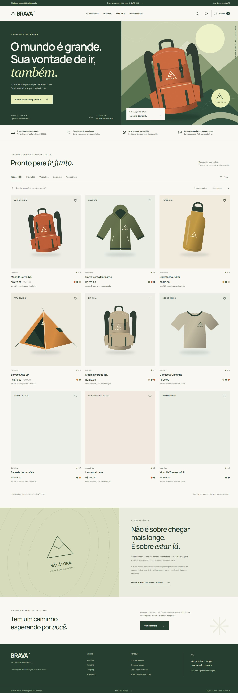

# Brava

**Menos rotina. Mais caminho.** Uma loja outdoor imaginária, com uma experiência completa de descoberta de produtos e compra simulada.

[Explorar demonstração](https://gustapaz.github.io/brava/)



## A experiência

- Nove equipamentos fictícios em quatro categorias, ilustrados em SVG, com variantes de cor e tamanho.
- Busca sem distinção de acentos, categorias, preço máximo, ordenação e estados vazios.
- Favoritos e sacola com persistência no navegador.
- Detalhes com zoom da ilustração, características e guia de medidas para vestuário.
- Quantidades, remoção de itens, cupom `BRAVA10`, três destinos de exemplo e frete simulado grátis a partir de R$ 500 em produtos, antes do desconto.
- Checkout com endereço fictício predefinido, confirmação obrigatória e comprovante de demonstração para baixar.
- Guia de mochilas, informações de entrega e privacidade, restauração das escolhas locais.

## Stack e implementação

HTML semântico, CSS e JavaScript puro com ES Modules. Vite 8 realiza o build; não há framework de interface nem runtime adicional. As regras de catálogo e carrinho ficam separadas do DOM e usam valores inteiros em centavos.

O plugin local de build inclui o catálogo no HTML inicial. O conteúdo da marca e os produtos podem ser lidos sem depender da renderização JavaScript; filtros, detalhes e sacola requerem JavaScript. Metadados, canonical, idioma e dimensões das imagens estão definidos. Os detalhes usam fragmentos de URL e podem ser abertos por link e recarregados no GitHub Pages.

Ilustrações e ícones SVG criados no projeto. Fonte Manrope variável hospedada localmente. Não há CDN, imagens remotas, analytics ou requisições a APIs de aplicação. Transições respeitam movimento reduzido. Diálogos nativos têm nomes acessíveis, foco inicial, ciclo de Tab e retorno ao controle que os abriu.

## Executar

Requer Node.js 24 ou superior e npm.

```sh
npm ci
npm run dev
npm test
npm run build
npm run preview
```

O endereço inclui `/brava/`. A saída está em `dist/`. O workflow de Pages executa instalação pelo lockfile, testes e build, e publica o artefato sem criar commits. A configuração de base segue a [documentação do Vite para GitHub Pages](https://vite.dev/guide/static-deploy.html#github-pages).

## Tudo é mockado

Brava é uma marca fictícia, sem operação comercial. Produtos, avaliações, estoque, especificações, preços, endereços, prazos, descontos e pedidos são demonstrativos. Não há pagamento, cobrança, autenticação, reserva de estoque, entrega, banco, backend ou envio de mensagens. Nenhum cartão, Pix, endereço real ou cadastro é solicitado.

Sacola, favoritos, cupom e destino de exemplo ficam na chave `brava-store` do localStorage. Limpar os dados do site remove essas escolhas. Não há sincronização entre dispositivos; abas do mesmo navegador acompanham mudanças via evento `storage`. O comprovante é um arquivo local e não é nota fiscal. A confirmação do pedido fica apenas na memória da sessão e esvazia a sacola local. Use conteúdo fictício. A hospedagem estática é sujeita à [política de privacidade do GitHub](https://docs.github.com/pt/site-policy/privacy-policies/github-general-privacy-statement).

## Validação

Oito testes automatizados cobrem busca/filtros/ordenação, favoritos, variantes, limites de quantidade, desconto e frete em centavos, frete grátis antes do cupom e recuperação de dados inválidos. Build de produção validado.

Verificação manual no navegador em 320, 390, 768 e 1440 pixels: navegação, filtros, variantes, guia de medidas, sacola, cupons válidos e inválidos, checkout, confirmação obrigatória, download do comprovante, favoritos, persistência, remoção e reset. Teclado: ciclo de foco nos diálogos, Escape e retorno ao controle anterior. Não foram medidos escores Lighthouse nem realizada uma auditoria completa com leitores de tela.

## Licenças

Código, ilustrações e ícones: [MIT](LICENSE), Gustavo Paz. Manrope: [SIL Open Font License 1.1](docs/MANROPE-OFL.txt). Cópias das licenças também são incluídas em `public/licenses/` na distribuição estática.
